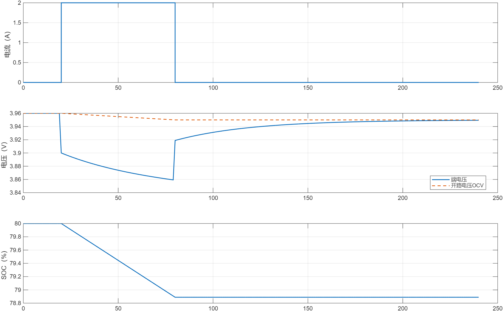
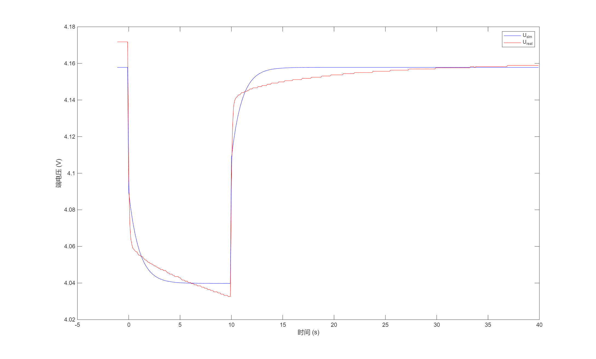

# 电池一阶 RC 模型仿真与 HPPC 参数辨识

[RC1.m](RC1.m) 用一阶 RC 等效电路模拟电池在放电脉冲下的端电压和荷电状态（SOC）。[parameters_identity.m](parameters_identity.m) 用 25 °C 的 HPPC 实验数据辨识欧姆内阻 $R_0$、极化电阻 $R_1$ 和极化电容 $C_1$。

HPPC（Hybrid Pulse Power Characterization，混合脉冲功率特性测试）通过短时充放电脉冲测量电池的电压响应。脚本用电流切换时的电压突变估计 $R_0$，用断流恢复曲线估算极化参数初值，再联合拟合放电段和恢复段，得到 $R_1$ 和 $C_1$。

## 运行方法

在 MATLAB 中将当前文件夹切换到本目录，运行仿真脚本。

```matlab
RC1
```

辨识脚本在文件中间定义了局部函数 `polarization_voltage`，按当前写法需要 MATLAB R2024a 或更新版本。[MathWorks 局部函数文档](https://www.mathworks.com/help/matlab/matlab_prog/local-functions-in-scripts.html)

运行辨识前，确认脚本首行的 `file_pwd` 指向本机的 [HPPC_25C_full.csv](HPPC_25C_full.csv)。如果 CSV 和脚本都在 MATLAB 当前文件夹，可以将该行改为 `file_pwd = fullfile(pwd, 'HPPC_25C_full.csv');`。运行后，命令窗口会显示辨识参数和端电压 RMSE，图窗会显示极化电压以及仿真与实测端电压的对比。

```matlab
parameters_identity
```

## 一阶 RC 模型仿真

等效电路由开路电压源、串联欧姆内阻 $R_0$ 和一个由 $R_1$ 与 $C_1$ 并联组成的极化支路构成。脚本约定放电电流为正，用安时积分更新 SOC，通过 `interp1` 对内置 SOC–OCV 表做线性插值，再扣除欧姆压降和极化电压 $U_p$ 得到端电压 $U_t$。

$$
\begin{aligned}
\mathrm{SOC}_{k+1} &= \mathrm{SOC}_k - \frac{I_k\,\Delta t}{3600Q} \\
U_{p,k+1} &= \alpha U_{p,k}+(1-\alpha)R_1 I_k,\qquad \alpha=e^{-\Delta t/(R_1C_1)} \\
U_{t,k} &= \mathrm{OCV}(\mathrm{SOC}_k)-I_kR_0-U_{p,k}
\end{aligned}
$$

| 项目 | 默认设置 |
| --- | --- |
| 容量 $Q$ | 3 Ah |
| $R_0$、$R_1$、$C_1$ | 0.03 Ω、0.02 Ω、2000 F |
| 初始状态 | SOC 为 80%，极化电压为 0 V |
| 仿真时间与步长 | 0–240 s，步长 1 s |
| 放电脉冲 | 第 20 s 接通 2 A 负载，第 80 s 断开 |

脚本绘制电流、端电压与开路电压、SOC 三张子图。接通负载时，端电压先因欧姆压降突降，再随极化电压建立和 SOC 下降而继续降低。断流时，端电压先回跳，然后逐渐趋近开路电压，SOC 保持在约 78.89%。



## HPPC 参数辨识

脚本读取 CSV 的 `Time`（s）、`Voltage`（V）和 `Current`（A）三列，并用 `I = -T.Current` 将放电电流转换为正值。以下索引是 MATLAB 数据表的行号，从 1 开始计数，表头除外。

| 数据段 | 行号 |
| --- | --- |
| 放电脉冲接通前后 | `1944 → 1945` |
| 放电脉冲段 | `1945:2045` |
| 放电脉冲断开前后 | `2045 → 2046` |
| 断流后的静置段 | `2046:2345` |
| 联合拟合与绘图窗口（去重前） | `1942:2345` |

### 欧姆内阻 $R_0$

分别取脉冲接通和断开前后的相邻采样点，计算两次电压变化量与电流变化量的绝对值之比，再取平均。

$$
R_0=\frac{1}{2}\left(\frac{|\Delta V_{\mathrm{on}}|}{|\Delta I_{\mathrm{on}}|}+\frac{|\Delta V_{\mathrm{off}}|}{|\Delta I_{\mathrm{off}}|}\right)
$$

### 用断流恢复曲线估算初值

将断流后第一个采样时刻记为 $t_{\mathrm{off}}$，以 $s=t-t_{\mathrm{off}}$ 作为静置段的相对时间。用 `fminsearch` 最小化静置电压的残差平方和，拟合恢复曲线。

$$
V_{\mathrm{rest}}(s)=B-Ae^{-s/\tau_{\mathrm{init}}}
$$

$B$ 为拟合曲线趋近的电压，$A$ 为电压恢复幅值，$\tau_{\mathrm{init}}$ 为时间常数初值。脚本以 $\log(\tau_{\mathrm{init}})$ 作为拟合变量，通过取指数保证时间常数为正。

初值估算将脉冲近似为恒流，并取脉冲前极化电压为零。用脉冲段的平均电流 $I_p$ 和脉冲首个采样点到静置首个采样点的时间差 $T_p$ 计算极化电阻初值。

$$
R_{1,\mathrm{init}}=\frac{A}{I_p\left(1-e^{-T_p/\tau_{\mathrm{init}}}\right)}
$$

### 联合拟合放电段与恢复段

从放电开始前 3 条数据到静置段末尾截取计算窗口。若相邻记录的时间、电流和电压均相同，只保留第一条。局部函数 `polarization_voltage` 将窗口首点的极化电压置为零，再用实际采样间隔 $\Delta t_k=t_{k+1}-t_k$ 与区间起点的实测电流 $I_k$ 递推极化电压。

$$
\begin{aligned}
\alpha_k &= e^{-\Delta t_k/\tau} \\
U_{p,k+1} &= \alpha_k U_{p,k}+(1-\alpha_k)R_1 I_k \\
U_{\mathrm{sim},k} &= B-I_kR_0-U_{p,k}
\end{aligned}
$$

联合拟合固定 $B$ 和 $R_0$，以初值估算得到的 $R_{1,\mathrm{init}}$、$\tau_{\mathrm{init}}$ 启动 `fminsearch`，在对数空间优化 $R_1$ 和 $\tau$。目标函数是放电段与恢复段的端电压均方误差之和，两段权重相同。放电前的静置点用于初始化和绘图，拟合权重为零。优化完成后，用 $C_1=\tau/R_1$ 计算极化电容。

### 参考结果与端电压对比

使用仓库内的 CSV 按脚本公式复算，得到以下结果。

| 参数 | 参考值 |
| --- | --- |
| $R_0$ | 0.0236 Ω |
| $B$ | 4.157819 V |
| $R_1$ | 17.086 mΩ |
| $\tau$ | 1.018 s |
| $C_1$ | 59.6 F |

脚本以放电脉冲首个采样点为绘图时间零点，输出极化电压和端电压对比图。全窗口 RMSE 包含放电前保留的静置点。

| 端电压误差统计范围 | RMSE |
| --- | --- |
| 全窗口 | 4.73 mV |
| 放电段 | 5.26 mV |
| 恢复段 | 4.41 mV |



更换数据时，按新脉冲更新 `R0_id`、`pulse_rows` 和 `rest_rows`。将辨识结果用于 `RC1.m` 仿真时，可手动替换脚本开头的 `R0`、`R1`、`C1`，电阻按 Ω 填写，例如将 17.086 mΩ 填为 `0.017086`。
